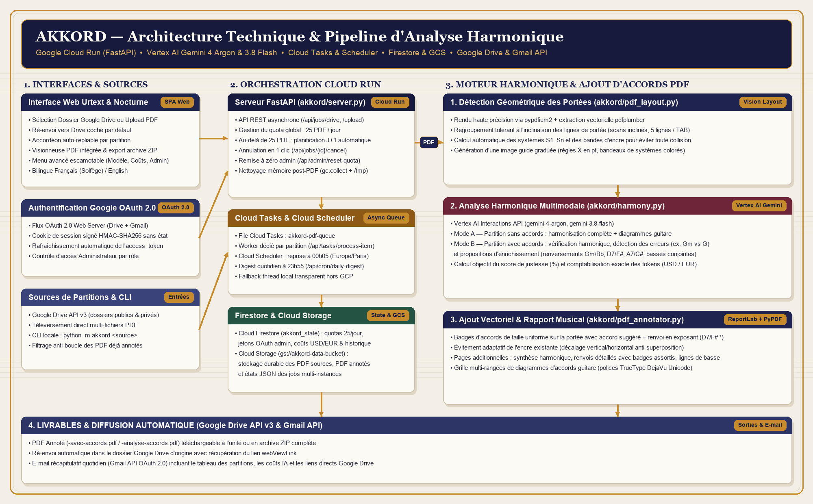
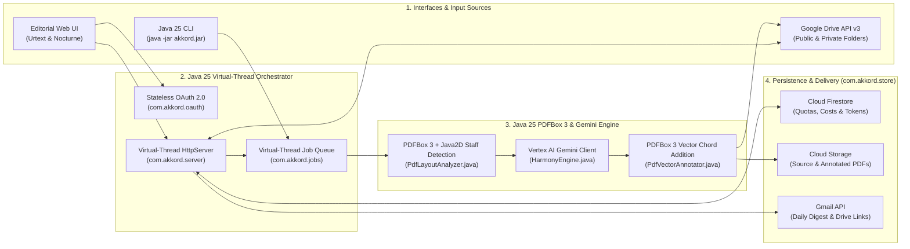
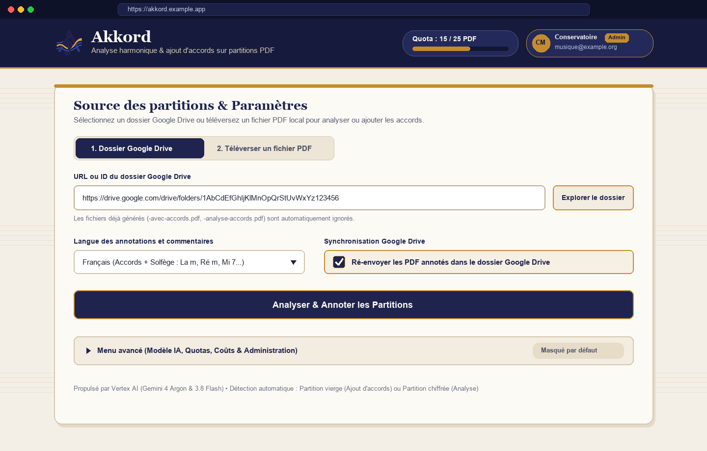
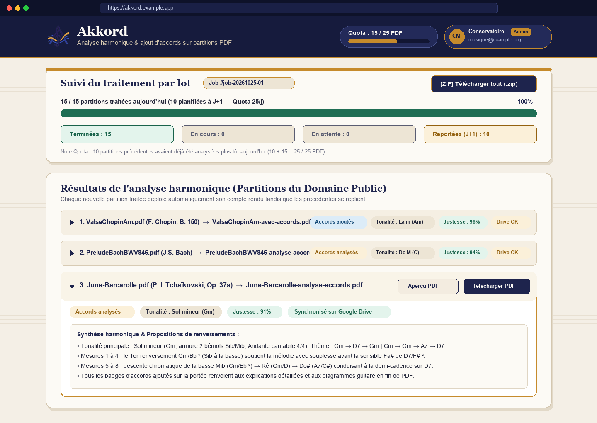
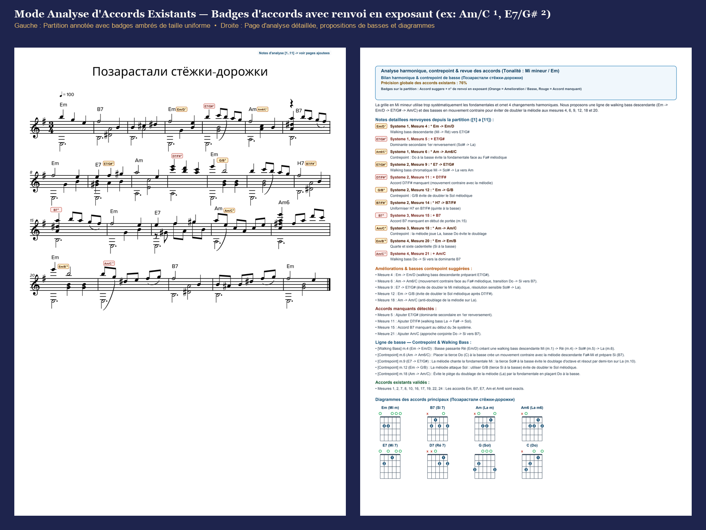
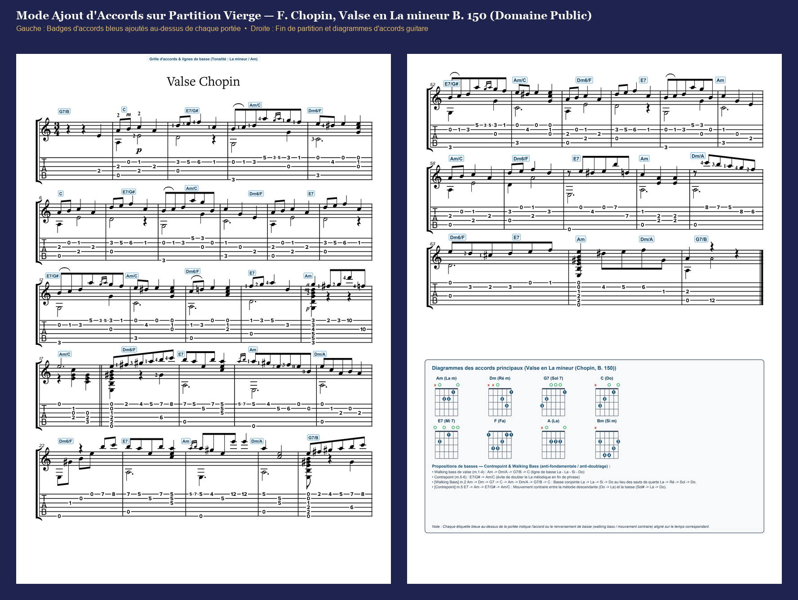
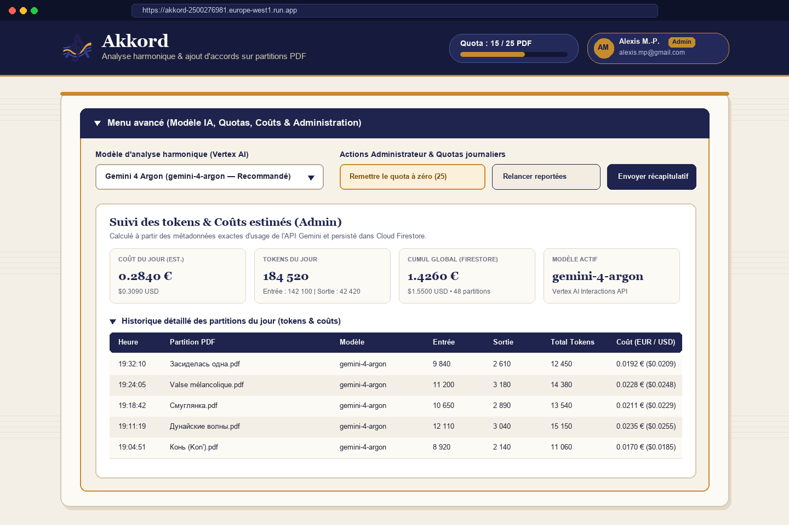

<p align="center">
  
</p>

<h1 align="center">Akkord — Harmonic Analysis & Automatic Chord Addition on PDF Sheet Music</h1>

<p align="center">
  <strong>Modern Java 25 (Virtual Threads + Apache PDFBox 3) musical score assistant powered by Vertex AI (Gemini 4 Argon & Gemini 3.8 Flash) and Google Cloud Run</strong><br/>
  Automatic chord addition on unchorded scores • Contrapuntal audit of existing chords • Guitar fretboard diagrams & bass line proposals
</p>

---

## 🎼 Overview

**Akkord** (`java-modern` branch) is a web application and command-line interface (CLI) migrated to **Modern Java 25 (standard OpenJDK 25 without GraalVM)**, designed to analyze musical sheet music in PDF format (public-domain classical guitar studies, vocal songbooks, lead sheets, guitar tablatures, and piano-vocal scores) and automatically produce **annotated PDF scores ready for the music stand**.

This branch implements the entire stack in **100% pure Modern Java 25**:
* **Java 25 Language & Concurrency**: Built with immutable `record` models, pattern matching for `switch`, text blocks, `java.net.http.HttpClient`, and **Virtual Threads (`Executors.newVirtualThreadPerTaskExecutor()`)** for non-blocking HTTP handling and concurrent PDF batch processing.
* **Pure-Java PDF Vision & Vector Engine (`Apache PDFBox 3.0` + `Java2D`)**: Performs multi-page high-DPI rasterization (`PDFRenderer`), contiguous-slice 5-line staff & 6-line TAB clustering, 2pt ink density grid computation, spiral low-ink collision avoidance, guide image rendering, and direct vector content-stream chord addition (`PDPageContentStream` in `AppendMode.APPEND`).
* **Fast Standard JVM Runtime (without GraalVM)**: Uses `eclipse-temurin:25-jre` with **AppCDS (Application Class-Data Sharing)**, **ZGC (`-XX:+UseZGC`, generational by default in Java 25)**, and **Compact Object Headers (`-XX:+UseCompactObjectHeaders`)**.

Depending on the content of each detected PDF score, **Akkord** automatically operates in one of two modes:

1. **Add Chords Mode (`-with-chords.pdf` / `-avec-accords.pdf`)** — *Scores without initial chord symbols*:
   * Detects the primary key signature and harmonic rhythm measure by measure (including guitar 3-sharp ledger-line protection so A major scores with low E bass notes are never misidentified as F#m).
   * Adds blue chord pills directly above each staff system using adaptive 2pt ink-collision avoidance.
   * Appends a multi-row guitar fretboard chord diagram chart and a guide for inverted bass chords (*slash chords*).
2. **Analyze Existing Chords Mode (`-chord-analysis.pdf` / `-analyse-accords.pdf`)** — *Scores that already include chord symbols*:
   * Verifies the harmonic accuracy of printed chords against the melody and key signature (e.g., distinguishing `Gm` vs `G` in D minor or G minor).
   * Adds **uniform-sized amber badges** above the staff displaying the **suggested chord together with a smaller superscript footnote number** (e.g., `E7/B ¹`, `E7/G# ²`, `Dm/F ³`, `G7/B ⁴`).
   * Appends dedicated harmonic analysis pages at the end of the PDF featuring matching numbered badges, contrapuntal explanations, walking-bass/inversion proposals, and guitar chord diagrams.

---

## 🏛️ Technical Architecture (Modern Java 25)



### End-to-End Processing Flow



### Software Components

| Class | Technical Role & Responsibilities |
| :--- | :--- |
| [`PdfLayoutAnalyzer.java`](src/main/java/com/akkord/pdf/PdfLayoutAnalyzer.java) | **Geometric staff and 2pt ink grid detection**: high-DPI rendering via Apache PDFBox 3 (`PDFRenderer`) and positioned text extraction (`PDFTextStripper`). Clusters 5-line staves (with tilt tolerance and outer beam stripping via `cleanSingleStaffCluster`), pairs 6-line `TAB` staves, computes `S1..Sn` coordinates, and renders the Java2D guide image. |
| [`HarmonyEngine.java`](src/main/java/com/akkord/harmony/HarmonyEngine.java) | **Vertex AI Gemini harmonic analysis engine**: queries **Gemini 4 Argon** (`gemini-4-argon`) and **Gemini 3.8 Flash** (`gemini-3.8-flash`) via `java.net.http.HttpClient`, applies 3-sharp guitar ledger-line protection, normalizes chord symbols, and computes both the objective harmonic accuracy score and token costs (`USD` / `EUR`). |
| [`PdfVectorAnnotator.java`](src/main/java/com/akkord/pdf/PdfVectorAnnotator.java) | **Vector PDF chord addition (`PDPageContentStream`)**: overlays chord badges onto the original score in `AppendMode.APPEND` with 2pt spiral low-ink collision avoidance, multi-row guitar fretboard diagrams, and appended harmonic analysis report pages. |
| [`JobQueueManager.java`](src/main/java/com/akkord/jobs/JobQueueManager.java) | **Virtual-Thread batch queue**: runs concurrent PDF workers on `Executors.newVirtualThreadPerTaskExecutor()`, enforces the global **25 PDFs / day** quota, defers overflow files (`deferred_next_day`), and packages completed outputs into a downloadable `.zip` archive. |
| [`CloudStore.java`](src/main/java/com/akkord/store/CloudStore.java) | **Firestore, GCS & daily activity digest**: persists the daily 25-PDF counter (with `quota_reset_baseline` support) and per-file token/cost breakdown in Cloud Firestore, and generates the 18:00 HTML daily summary email. |
| [`OAuthManager.java`](src/main/java/com/akkord/oauth/OAuthManager.java) | **Stateless Google OAuth 2.0 authentication**: handles the OAuth 2.0 Web Server flow and signs user sessions inside a `v1.<b64>.<sig>` `Deflater` + `HmacSHA256` cookie. |
| [`AkkordHttpServer.java`](src/main/java/com/akkord/server/AkkordHttpServer.java) & [`Main.java`](src/main/java/com/akkord/Main.java) | **Virtual-Thread HTTP Web Server & CLI**: exposes the REST API, serves the *Conservatory Urtext & Nocturne* web interface ([`akkord/static/`](akkord/static/)), and provides the CLI runner. |

---

## 📖 Complete User Guide

### 1. Main Interface Overview & Google Drive Sign-In



When you open **Akkord**, the top navigation bar displays:
* **The Daily Quota Pill** (`Quota: X / 25 PDFs`), showing how many scores have been processed during the current calendar day.
* **Google OAuth 2.0 Sign-In**:
  * Analyzing a **public Google Drive folder** or uploading local PDFs requires no sign-in.
  * Accessing a **private Google Drive folder** or **automatically re-uploading annotated PDFs back to your Drive folder** is enabled by clicking **"Sign in with Google"**.

---

### 2. Batch Processing Progress, Auto-Collapsing Accordion & 25 PDF/Day Quota



Clicking **"Analyze & Annotate Sheet Music"** launches an asynchronous batch job:
* **Real-Time Progress Bar**: displays live counters for **Completed**, **Running**, **Queued**, and **Deferred (Next Day)** scores.
* **Automatic Multi-Day Scheduling Above 25 PDFs**: overflow files (`> 25`) are marked `deferred_next_day` and resumed automatically the next day.
* **Auto-Expanding Result Accordion**: whenever a new score finishes processing, its detailed report automatically opens while previously opened items collapse.

---

### 3. Reading Annotated PDF Scores

#### A. Analyze Existing Chords Mode (`-chord-analysis.pdf`)



*Example above using a Public Domain classical guitar work from the Mutopia Project: **Matteo Carcassi (1792–1853) — Etude No. 7, Op. 60 in A Minor** ([`samples/Carcassi-Op60-No7.pdf`](samples/Carcassi-Op60-No7.pdf)).*

#### B. Add Chords Mode on Unchorded Scores (`-with-chords.pdf`)



*Example above using a Public Domain classical guitar work from the Mutopia Project: **Matteo Carcassi (1792–1853) — Etude No. 3, Op. 60 in A Major** ([`samples/Carcassi-Op60-No3.pdf`](samples/Carcassi-Op60-No3.pdf)).*

---

### 4. Advanced Menu: AI Model Selection, Token Costs & Quota Administration



Expanding the **"Advanced Menu"** drawer provides access to:
1. **Harmonic Analysis Model**: choose between **Gemini 4 Argon** (`gemini-4-argon`) and **Gemini 3.8 Flash** (`gemini-3.8-flash`).
2. **Administrator Actions & Daily Quota Controls**: reset the daily quota to `0 / 25`, resume deferred PDFs, or send the daily digest email.
3. **Token Usage & Estimated Costs**: view today's and cumulative token/cost totals (`EUR` & `USD`).

---

### 5. Command-Line Interface (CLI)

```bash
# Analyze a local folder of scores in English (using Gemini 4 Argon by default)
java -jar target/akkord.jar ./samples --lang en --model gemini-4-argon --output-dir ./outputs

# Use Gemini 3.8 Flash for fast processing on a single score
java -jar target/akkord.jar ./samples/Carcassi-Op60-No3.pdf --lang en --model gemini-3.8-flash --output-dir ./outputs

# Analyze a Google Drive folder and re-upload annotated PDFs back to Drive
java -jar target/akkord.jar "https://drive.google.com/drive/folders/YOUR_FOLDER_ID" --lang en --upload-to-drive
```

---

## 🚀 Local Build, Testing & Cloud Run Deployment

### Prerequisites
* **OpenJDK 25+** (standard JVM — no GraalVM required)
* **Apache Maven 3.9+**

### Build & Run Tests

```bash
# Run the JUnit 5 test suite and build the shaded executable JAR (target/akkord.jar)
mvn test package
```

### Run the Web Server Locally

```bash
java -XX:+UseZGC -XX:+UseCompactObjectHeaders -jar target/akkord.jar serve --port 8080
```
Then open `http://localhost:8080` in your browser.

### Deploy to Google Cloud Run

```bash
gcloud run deploy akkord \
  --source=. \
  --project=YOUR_GCP_PROJECT \
  --region=europe-west1 \
  --allow-unauthenticated
```

---

## License

See [LICENSE](LICENSE) (Apache License, Version 2.0).

## Disclaimer

This is not an official Google project.
