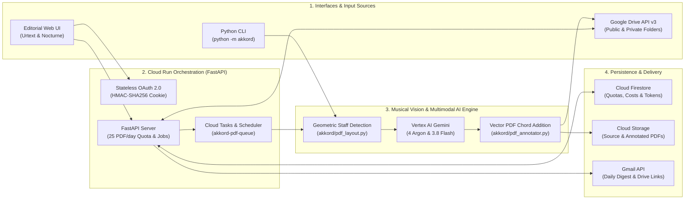

<p align="center">
  
</p>

<h1 align="center">Akkord — Harmonic Analysis & Automatic Chord Addition on PDF Sheet Music</h1>

<p align="center">
  <strong>AI-powered musical score assistant built on Vertex AI (Gemini 4 Argon & Gemini 3.8 Flash) and Google Cloud Run</strong><br/>
  Automatic chord addition on unchorded scores • Contrapuntal audit of existing chords • Guitar fretboard diagrams & bass line proposals
</p>

---

## 🎼 Overview

**Akkord** is a web application and command-line interface (CLI) designed to analyze musical sheet music in PDF format (public-domain classical guitar studies, vocal songbooks, lead sheets, guitar tablatures, and piano-vocal scores) and automatically produce **annotated PDF scores ready for the music stand**.

Depending on the content of each detected PDF score, **Akkord** automatically operates in one of two modes:

1. **Add Chords Mode (`-with-chords.pdf` / `-avec-accords.pdf`)** — *Scores without initial chord symbols*:
   * Detects the primary key signature and harmonic rhythm measure by measure.
   * Adds blue chord pills directly above each staff system using adaptive ink-collision avoidance.
   * Appends a multi-row guitar fretboard chord diagram chart and a guide for inverted bass chords (*slash chords*).
2. **Analyze Existing Chords Mode (`-chord-analysis.pdf` / `-analyse-accords.pdf`)** — *Scores that already include chord symbols*:
   * Verifies the harmonic accuracy of printed chords against the melody and key signature (e.g., distinguishing `Gm` vs `G` in D minor or G minor).
   * Adds **uniform-sized amber badges** above the staff displaying the **suggested chord together with a smaller superscript footnote number** (e.g., `E7/B ¹`, `E7/G# ²`, `Dm/F ³`, `G7/B ⁴`).
   * Appends dedicated harmonic analysis pages at the end of the PDF featuring matching numbered badges, contrapuntal explanations, walking-bass/inversion proposals, and guitar chord diagrams.

---

## 🏛️ Technical Architecture


### End-to-End Processing Flow



### Software Components

| Module | Technical Role & Responsibilities |
| :--- | :--- |
| [`akkord/pdf_layout.py`](akkord/pdf_layout.py) | **Geometric staff and ink detection**: high-DPI raster rendering via `pypdfium2` combined with vector inspection via `pdfplumber`. Clusters 5-line staves (with tilt tolerance for skewed scans and automatic stripping of outer beam lines), pairs 6-line `TAB` staves, computes vertical coordinates for every system (`S1..Sn`), and generates the graduated guide image sent to the multimodal model. |
| [`akkord/harmony.py`](akkord/harmony.py) | **Vertex AI harmonic analysis engine**: queries Gemini models such as **Gemini 4 Argon** (`gemini-4-argon`) and **Gemini 3.8 Flash** (`gemini-3.8-flash`) via the Google GenAI Interactions API, ensures full coverage across all detected staff systems, normalizes chord notation (English standard or French Solfège), and computes both the objective harmonic accuracy score and exact token cost (`USD` / `EUR`). |
| [`akkord/pdf_annotator.py`](akkord/pdf_annotator.py) | **Vector PDF chord addition**: overlays chord badges onto the original score via `ReportLab` and `PyPDF` without altering the underlying notation. Uses `DejaVuSans` TrueType fonts for full Unicode support, musical accidentals (`♭`, `♯`), and superscript reference numbers (`¹`, `²`, `³`), with adaptive ink avoidance. |
| [`akkord/job_queue.py`](akkord/job_queue.py) | **Asynchronous batch queue & Cloud Tasks**: dispatches each batch into per-file tasks in Google Cloud Tasks (`akkord-pdf-queue`), enforces the global **25 PDFs / day** quota, automatically schedules overflow files (`> 25`) for the next day (`deferred_next_day`), and packages completed outputs into a downloadable `.zip` archive. |
| [`akkord/activity.py`](akkord/activity.py) & [`akkord/firestore_store.py`](akkord/firestore_store.py) | **Quota management, token accounting, and Gmail digest**: persists the daily 25-PDF counter and per-file token/cost breakdown (`USD`/`EUR`) in Cloud Firestore (`akkord_state`), and sends a daily HTML summary email via the Gmail API containing direct links to the updated files in Google Drive. |
| [`akkord/oauth.py`](akkord/oauth.py) | **Stateless Google OAuth 2.0 authentication**: handles the OAuth 2.0 Web Server flow (`drive` and `gmail.send` scopes), signs user sessions inside a container-resilient `HttpOnly` HMAC-SHA256 cookie, and automatically refreshes expired access tokens. |
| [`akkord/server.py`](akkord/server.py) & [`akkord/static/`](akkord/static/) | **FastAPI Web Server & Editorial UI**: exposes the REST API and serves the *Conservatory Urtext & Nocturne* web interface (warm vellum `#f4efe6`, midnight indigo `#1e244d`, burnished gold `#c68b2c`, *Cormorant Garamond* & *Plus Jakarta Sans* typography). |

---

## 📖 Complete User Guide

### 1. Main Interface Overview & Google Drive Sign-In


When you open **Akkord**, the top navigation bar displays:
* **The Daily Quota Pill** (`Quota: X / 25 PDFs`), showing how many scores have been processed during the current calendar day.
* **Google OAuth 2.0 Sign-In**:
  * Analyzing a **public Google Drive folder** or uploading local PDFs requires no sign-in.
  * Accessing a **private Google Drive folder** or **automatically re-uploading annotated PDFs back to your Drive folder** is enabled by clicking **"Sign in with Google"**.

The central workspace provides two input tabs:
1. **1. Google Drive Folder**: paste the full URL or folder ID of a Google Drive folder containing your PDF scores.
2. **2. Upload PDF File(s)**: drag and drop one or more `.pdf` files directly from your computer.

> **Tip:** The **"Re-upload annotated PDFs to Google Drive folder"** option is **checked by default**. Generated files (`-with-chords.pdf` or `-chord-analysis.pdf`) are uploaded back into the source folder and automatically ignored on subsequent runs to prevent re-processing loops.

---

### 2. Batch Processing Progress, Auto-Collapsing Accordion & 25 PDF/Day Quota


Clicking **"Analyze & Annotate Sheet Music"** launches an asynchronous batch job:

* **Real-Time Progress Bar**: displays live counters for **Completed**, **Running**, **Queued**, and **Deferred (Next Day)** scores.
* **Automatic Multi-Day Scheduling Above 25 PDFs**:
  * If a folder contains 35 PDF scores, the **first 25** are processed immediately (up to the remaining daily quota).
  * The **remaining 10 scores** are marked `Scheduled for Next Day (25/day Quota)` and are automatically resumed at `00:05` the next day by Cloud Scheduler (or immediately if an administrator resets the daily quota).
* **Auto-Expanding Result Accordion**:
  * Clicking the chevron arrow (`▸` / `▾`) to the left of any score title expands or collapses its harmonic report.
  * **Whenever a new score finishes processing**, its detailed report (harmonic summary, detected key, accuracy score, **Preview PDF**, and **Download PDF** buttons) **automatically opens while all previously opened items collapse**, keeping the workspace clean and focused.
* **Bulk Export**: click **"[ZIP] Download All (.zip)"** to download all annotated PDFs from the batch in a single archive.

---

### 3. Reading Annotated PDF Scores

#### A. Analyze Existing Chords Mode (`-chord-analysis.pdf`)


*Example above using a Public Domain classical guitar work from the Mutopia Project: **Matteo Carcassi (1792–1853) — Etude No. 7, Op. 60 in A Minor** ([`samples/Carcassi-Op60-No7.pdf`](samples/Carcassi-Op60-No7.pdf)).*

When the score already contains chord symbols or an explicit harmonic structure:
* **On the Score (Left Page)**: whenever a chord can be refined or enriched (e.g., first/second inversion, leading-tone bass, passing chord), Akkord adds a **uniform-sized amber badge** displaying the **suggested chord followed by a smaller superscript reference number** (`E7/B ¹`, `E7/G# ²`, `Dm/F ³`, `G7/B ⁴`).
* **On the Appended Analysis Pages (Right Page)**:
  * A summary banner reports the **detected key** (`A minor / Am`), **overall harmonic accuracy (%)**, and general musical assessment.
  * The **"Detailed Score Footnotes"** section repeats each numbered badge (`E7/B ¹`, `E7/G# ²`...) along with its system index, measure number, original chord, and full contrapuntal explanation.
  * The **"Bass Line — Counterpoint & Walking Bass"** section outlines stepwise and contrary-motion bass progressions.
  * The **"Main Guitar Chord Diagrams"** grid illustrates fretboard fingerings for the piece's key chords.

#### B. Add Chords Mode on Unchorded Scores (`-with-chords.pdf`)


*Example above using a Public Domain classical guitar work from the Mutopia Project: **Matteo Carcassi (1792–1853) — Etude No. 3, Op. 60 in A Major** ([`samples/Carcassi-Op60-No3.pdf`](samples/Carcassi-Op60-No3.pdf)).*

When the score contains only notation without chord symbols:
* **On the Score (Left Page)**: blue chord pills (`A`, `E7/B`, `A/C#`, `D`, `B7/D#`...) are added above every staff system, automatically nudging around titles, tempo markings, and high notes.
* **At the End of the Score (Right Page)**: a dedicated chart displays the **guitar chord diagrams** together with walking-bass and slash-chord guidance.

---

### 4. Advanced Menu: AI Model Selection, Token Costs & Quota Administration


To keep the main interface uncluttered, technical settings and administrator tools are tucked inside the collapsible **"Advanced Menu (AI Model, Quotas, Token Costs & Administration)"** drawer at the bottom of the main card.

Expanding this menu provides access to:
1. **Harmonic Analysis Model**: choose between Vertex AI Gemini models such as **Gemini 4 Argon** (`gemini-4-argon`, recommended for deep contrapuntal reasoning) and **Gemini 3.8 Flash** (`gemini-3.8-flash`, optimized for high speed and low cost).
2. **Administrator Actions & Daily Quota Controls** (restricted to authenticated administrators):
   * **Reset Daily Quota to 0 (25)**: immediately resets the daily counter to `0 / 25` while preserving the day's token and cost audit log.
   * **Resume Deferred PDFs**: triggers immediate processing of scores previously deferred to the next day.
   * **Send Daily Digest**: immediately sends the daily HTML summary email (via the Gmail API) featuring the processed scores table, AI token costs, and **direct links to the updated PDF files in Google Drive**.
3. **Token Usage & Estimated Costs**:
   * Summary cards displaying today's estimated cost (`EUR` & `USD`), token breakdown (input vs. output), and cumulative totals persisted in Cloud Firestore.
   * Expandable **"Detailed History of Today's Processed Scores (Tokens & Costs)"** table listing every analyzed score.

---

### 5. Command-Line Interface (CLI)

**Akkord** can also be run directly from a terminal on a single PDF file, a local directory, or a Google Drive folder:

```bash
# Analyze a local folder of scores in English (using Gemini 4 Argon by default)
python -m akkord ./samples --lang en --model gemini-4-argon --output-dir ./outputs

# Use Gemini 3.8 Flash for fast processing on a single score
python -m akkord ./samples/Carcassi-Op60-No3.pdf --lang en --model gemini-3.8-flash --output-dir ./outputs

# Analyze a Google Drive folder and re-upload annotated PDFs back to Drive
python -m akkord "https://drive.google.com/drive/folders/YOUR_FOLDER_ID" --lang en --upload-to-drive
```

---

## 🚀 Local Setup, Testing & Cloud Run Deployment

### Prerequisites
* **Python 3.12+**
* A Google Cloud project with the **Vertex AI**, **Cloud Run**, **Cloud Tasks**, **Cloud Firestore**, **Cloud Storage**, **Google Drive API**, and **Gmail API** enabled.

### Local Installation

```bash
python3 -m venv .venv
source .venv/bin/activate
pip install -r requirements.txt
```

### Run the Web Server Locally

```bash
uvicorn akkord.server:app --reload --port 8080
```
Then open `http://localhost:8080` in your browser.

### Run the Unit & Integration Test Suite

```bash
pytest tests/ -v
```

### Deploy to Google Cloud Run

```bash
gcloud run deploy akkord \
  --source=. \
  --project=YOUR_GCP_PROJECT \
  --region=europe-west1 \
  --allow-unauthenticated
```

---

## License

See [LICENSE](LICENSE) (Apache License, Version 2.0).

## Disclaimer

This is not an official Google project.
