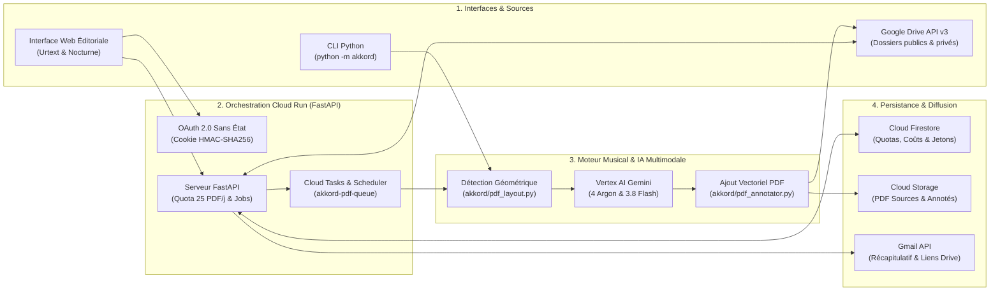

<p align="center">
  
</p>

<h1 align="center">Akkord — Analyse Harmonique & Ajout d'Accords sur Partitions PDF</h1>

<p align="center">
  <strong>Assistant d'édition musicale propulsé par Vertex AI (Gemini 4 Argon & Gemini 3.8 Flash) sur Google Cloud Run</strong><br/>
  Harmonisation automatique de partitions vierges • Audit contrapuntique d'accords existants • Diagrammes guitare & lignes de basse
</p>

---

## 🎼 Présentation

**Akkord** est une application web et un outil en ligne de commande (CLI) conçu pour analyser des partitions musicales au format PDF (pièces classiques du domaine public, recueils vocaux, tablatures guitare, partitions piano/chant) et produire automatiquement des **partitions PDF annotées prêtes pour le pupitre**.

Selon la nature de chaque partition détectée, **Akkord** opère automatiquement dans l'un des deux modes suivants :

1. **Mode Ajout d'accords (`-avec-accords.pdf` / `-with-chords.pdf`)** — *Partition sans accords initiaux* :
   * Détection de la tonalité principale et de la carrure harmonique mesure par mesure.
   * Ajout de badges d'accords bleus directement au-dessus de chaque système de portées avec évitement adaptatif des collisions d'encre.
   * Génération en fin de partition d'une grille multi-rangées de diagrammes d'accords guitare et d'un guide des accords avec basse inversée (*slash chords*).
2. **Mode Analyse & Enrichissement d'accords existants (`-analyse-accords.pdf` / `-chord-analysis.pdf`)** — *Partition comportant déjà des accords chiffrés* :
   * Vérification de la justesse harmonique des accords imprimés par rapport à la mélodie et à l'armure (ex. distinction `Gm` vs `G` en Ré mineur ou Sol mineur).
   * Ajout sur la portée de **badges ambrés de taille uniforme** affichant directement **l'accord suggéré accompagné d'un numéro de renvoi en exposant** (ex. `Gm/Bb ¹`, `D7/F# ²`, `Cm/Eb ³`, `A7/C# ⁴`).
   * Ajout de pages de rapport harmonique détaillé en fin de PDF reprenant chaque badge numéroté, l'explication contrapuntique, les propositions de lignes de basse conjointes et les diagrammes d'accords guitare.

---

## 🏛️ Architecture Technique


### Flux de traitement de bout en bout



### Détail des composants logiciels

| Module | Rôle et responsabilités techniques |
| :--- | :--- |
| [`akkord/pdf_layout.py`](akkord/pdf_layout.py) | **Détection géométrique des portées et de l'encre** : rendu raster haute résolution via `pypdfium2` et inspection vectorielle via `pdfplumber`. Regroupe les groupes de 5 lignes de portée (avec tolérance à l'inclinaison sur les scans penchés), associe les portées de tablature (`TAB`), calcule les coordonnées verticales de chaque système (`S1..Sn`) et génère l'image guide graduée transmise au modèle multimodal. |
| [`akkord/harmony.py`](akkord/harmony.py) | **Moteur d'analyse harmonique Vertex AI** : interroge les modèles Gemini tels que **Gemini 4 Argon** (`gemini-4-argon`) et **Gemini 3.8 Flash** (`gemini-3.8-flash`) via l'API Interactions de Google GenAI, garantit la couverture complète de tous les systèmes de portées, normalise la notation musicale (Français Solfège / Anglais) et calcule le score objectif de justesse harmonique ainsi que le coût exact en tokens (`USD` / `EUR`). |
| [`akkord/pdf_annotator.py`](akkord/pdf_annotator.py) | **Ajout vectoriel d'accords sur PDF** : superpose via `ReportLab` et `PyPDF` les badges d'accords sur la partition originale sans altérer le document existant. Utilise la police TrueType `DejaVuSans` pour un rendu parfait des caractères internationaux, des symboles musicaux (`♭`, `♯`) et des numéros de renvoi en exposant (`¹`, `²`, `³`), avec algorithme d'évitement adaptatif de l'encre. |
| [`akkord/job_queue.py`](akkord/job_queue.py) | **File d'attente asynchrone par lot & Cloud Tasks** : découpe chaque lot en tâches unitaires dans Google Cloud Tasks (`akkord-pdf-queue`), applique le quota journalier de **25 PDF / jour**, planifie automatiquement les fichiers au-delà de 25 au lendemain (`deferred_next_day`), et permet l'export en archive `.zip`. |
| [`akkord/activity.py`](akkord/activity.py) & [`akkord/firestore_store.py`](akkord/firestore_store.py) | **Quotas, comptabilité des tokens et rapport Gmail** : persiste dans Cloud Firestore (`akkord_state`) le compteur quotidien de 25 PDF, le suivi détaillé des tokens et coûts (`USD`/`EUR`) par fichier, et envoie chaque soir un e-mail récapitulatif HTML via l'API Gmail incluant les liens directs vers les fichiers mis à jour sur Google Drive. |
| [`akkord/oauth.py`](akkord/oauth.py) | **Authentification Google OAuth 2.0 sans état** : gère le flux OAuth 2.0 Web Server (scopes `drive` et `gmail.send`), signe les sessions dans un cookie `HttpOnly` HMAC-SHA256 résistant au redémarrage des conteneurs et rafraîchit automatiquement les jetons expirés. |
| [`akkord/server.py`](akkord/server.py) & [`akkord/static/`](akkord/static/) | **Serveur Web FastAPI & Interface Éditoriale** : expose l'API REST et sert l'interface web au design *Conservatory Urtext & Nocturne* (vélin crème `#f4efe6`, indigo nocturne `#1e244d`, or bruni `#c68b2c`, typographies *Cormorant Garamond* & *Plus Jakarta Sans*). |

---

## 📖 Guide Utilisateur Complet

### 1. Vue d'ensemble de l'interface et connexion Google Drive


À l'ouverture d'**Akkord**, la barre supérieure affiche :
* **Le compteur de quota journalier** (`Quota : X / 25 PDF`) indiquant le nombre de partitions analysées au cours de la journée (fuseau `Europe/Paris`).
* **Le bouton de connexion Google OAuth 2.0** :
  * Pour analyser un **dossier Google Drive public**, aucune connexion n'est requise.
  * Pour accéder à un **dossier Google Drive privé** ou **ré-envoyer automatiquement les PDF annotés dans votre dossier Drive**, cliquez sur **« Se connecter avec Google »**.

L'espace de travail central propose deux modes d'entrée via deux onglets :
1. **1. Dossier Google Drive** : collez l'URL complète ou l'identifiant d'un dossier Google Drive contenant vos partitions PDF.
2. **2. Téléverser un fichier PDF** : glissez-déposez un ou plusieurs fichiers `.pdf` depuis votre ordinateur.

> **Astuce :** L'option **« Ré-envoyer les PDF annotés dans le dossier Google Drive »** est **cochée par défaut**. Les fichiers générés (`-avec-accords.pdf` ou `-analyse-accords.pdf`) sont déposés directement dans le dossier d'origine et ignorés lors des analyses suivantes pour éviter toute boucle.

---

### 2. Suivi du traitement par lot, accordéon des résultats et quota de 25 PDF/jour


Dès que vous cliquez sur **« Analyser & Annoter les Partitions »**, un job asynchrone est créé :

* **Barre de progression en temps réel** : affiche le nombre de partitions **Terminées**, **En cours**, **En attente** et **Reportées (J+1)**.
* **Gestion automatique des lots de plus de 25 partitions** :
  * Si votre dossier contient par exemple 35 partitions PDF, les **25 premières** sont traitées immédiatement.
  * Les **10 partitions suivantes** reçoivent le statut `Planifié le J+1 (Quota 25/j)` et sont automatiquement reprises le lendemain à `00h05` par Cloud Scheduler (ou immédiatement si l'administrateur remet le quota à zéro).
* **Ouverture automatique du dernier compte rendu (Accordéon)** :
  * Dans la liste des résultats, un simple clic sur la flèche à gauche du titre déplie ou replie les détails d'une partition.
  * **À chaque nouvelle partition terminée**, son compte rendu complet (synthèse harmonique, tonalité détectée, score de justesse, boutons **Aperçu PDF** et **Télécharger PDF**) **s'ouvre automatiquement tandis que les partitions précédentes se replient** pour garder l'écran lisible.
* **Téléchargement groupé** : le bouton **« Télécharger tout (.zip) »** rassemble toutes les partitions annotées du lot dans une archive ZIP unique.

---

### 3. Lecture des partitions PDF annotées

#### A. Mode Analyse d'accords existants (`-analyse-accords.pdf`)


*Exemple ci-dessus sur une œuvre du domaine public : **P. I. Tchaïkovski — Juin : Barcarolle, op. 37a n° 6**.*

Lorsque la partition d'origine comporte déjà des accords imprimés :
* **Sur la partition (page de gauche)** : lorsqu'un accord peut être corrigé ou enrichi (renversement, chiffrage plus précis, accord de passage), Akkord ajoute un **badge ambré de taille uniforme** contenant **l'accord suggéré suivi d'un numéro de renvoi en exposant** (par exemple `Gm/Bb ¹`, `D7/F# ²`, `Cm/Eb ³`, `A7/C# ⁴`).
* **Sur les pages d'analyse ajoutées en fin de document (page de droite)** :
  * Un bandeau récapitule la **tonalité détectée** (`Sol mineur / Gm`), le **score de justesse harmonique (%)** et l'appréciation générale.
  * La section **« Notes détaillées renvoyées depuis la partition »** reprend chaque badge numéroté (`Gm/Bb ¹`, `D7/F# ²`...) avec le système, la mesure concernée, l'accord initial et la justification musicale complète.
  * La section **« Ligne de basse — Contrepoint & Walking Bass »** détaille les mouvements de basse conjoints possibles.
  * La **grille de diagrammes d'accords guitare** illustre les doigtés de tous les accords de la pièce.

#### B. Mode Ajout d'accords sur partition vierge (`-avec-accords.pdf`)


*Exemple ci-dessus sur une œuvre du domaine public : **F. Chopin — Valse en La mineur, B. 150**.*

Lorsque la partition ne contient que la mélodie ou la tablature sans chiffrage :
* **Sur la partition (page de gauche)** : des badges d'accords bleus (`Am`, `Dm6/F`, `E7/G#`, `C`, `G7/B`...) sont ajoutés et alignés au-dessus de chaque système de portées en évitant automatiquement les titres, indications de tempo et notes hautes.
* **En fin de partition (page de droite)** : un encadré dédié présente les **diagrammes d'accords guitare** (avec notation solfège entre parenthèses en français : `Am (La m)`, `Dm (Ré m)`, `E7 (Mi 7)`) ainsi qu'un guide des lignes de basse et renversements.

---

### 4. Menu avancé : Modèle IA, suivi des coûts et administration


Pour conserver une interface épurée au quotidien, les réglages techniques et les outils d'administration sont regroupés dans le panneau repliable **« Menu avancé (Modèle IA, Quotas, Coûts & Administration) »** situé en bas de la carte principale.

En dépliant ce menu, vous accédez à :
1. **Modèle d'analyse harmonique** : sélection du modèle Vertex AI, par exemple **Gemini 4 Argon** (`gemini-4-argon`, recommandé pour l'analyse contrapuntique approfondie) ou **Gemini 3.8 Flash** (`gemini-3.8-flash`, optimisé pour la rapidité et le coût).
2. **Actions d'administration (réservées à l'administrateur connecté)** :
   * **Remettre le quota à zéro (25)** : réinitialise immédiatement le compteur journalier à `0 / 25` tout en conservant l'historique comptable des tokens de la journée.
   * **Relancer reportées** : déclenche sans attendre le traitement des partitions planifiées à J+1.
   * **Envoyer récapitulatif** : envoie immédiatement par e-mail (via Gmail API) le bilan HTML de la journée avec le détail des partitions, les coûts IA et les **liens directs vers les fichiers mis à jour dans Google Drive**.
3. **Suivi des tokens & Coûts estimés** :
   * Cartes récapitulatives du coût du jour (`EUR` & `USD`), du volume de tokens (entrée / sortie) et du cumul global persisté dans Firestore.
   * Tableau dépliable **« Historique détaillé des partitions du jour (tokens & coûts) »** listant chaque partition traitée.

---

### 5. Utilisation en ligne de commande (CLI)

**Akkord** peut également être exécuté directement depuis un terminal sur un fichier PDF local, un dossier local ou un dossier Google Drive :

```bash
# Analyser un dossier local de partitions en français (avec Gemini 4 Argon par défaut)
python -m akkord ./samples --lang fr --model gemini-4-argon --output-dir ./outputs

# Utiliser Gemini 3.8 Flash pour un traitement rapide
python -m akkord ./samples/ValseChopinAm.pdf --lang fr --model gemini-3.8-flash --output-dir ./outputs

# Analyser un dossier Google Drive et ré-envoyer les PDF annotés sur Drive
python -m akkord "https://drive.google.com/drive/folders/VOTRE_FOLDER_ID" --lang fr --upload-to-drive
```

---

## 🚀 Installation Locale, Tests & Déploiement Cloud Run

### Prérequis
* **Python 3.12+**
* Un projet Google Cloud avec les API **Vertex AI**, **Cloud Run**, **Cloud Tasks**, **Cloud Firestore**, **Cloud Storage**, **Google Drive API** et **Gmail API** activées.

### Installation locale

```bash
python3 -m venv .venv
source .venv/bin/activate
pip install -r requirements.txt
```

### Lancer le serveur web en local

```bash
uvicorn akkord.server:app --reload --port 8080
```
Ouvrez ensuite `http://localhost:8080` dans votre navigateur.

### Exécuter la suite de tests unitaires et d'intégration

```bash
pytest tests/ -v
```

### Déployer sur Google Cloud Run

```bash
gcloud run deploy akkord \
  --source=. \
  --project=VOTRE_PROJET_GCP \
  --region=europe-west1 \
  --allow-unauthenticated
```

---

## License

Voir le fichier [LICENSE](LICENSE) (Apache License, Version 2.0).

## Disclaimer

This is not an official Google project.
