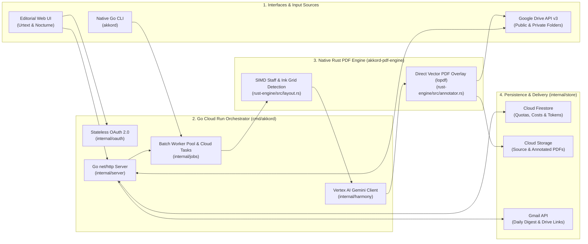

<p align="center">
  
</p>

<h1 align="center">Akkord — Harmonic Analysis & Automatic Chord Addition on PDF Sheet Music</h1>

<p align="center">
  <strong>High-performance Go + Rust polyglot musical score assistant powered by Vertex AI (Gemini 4 Argon & Gemini 3.8 Flash) and Google Cloud Run</strong><br/>
  Automatic chord addition on unchorded scores • Contrapuntal audit of existing chords • Guitar fretboard diagrams & bass line proposals
</p>

---

## 🎼 Overview

**Akkord** (`go-rust-polyglot` branch) is a high-performance web application and command-line interface (CLI) designed to analyze musical sheet music in PDF format (public-domain classical guitar studies, vocal songbooks, lead sheets, guitar tablatures, and piano-vocal scores) and automatically produce **annotated PDF scores ready for the music stand**.

This branch implements the **Go + Rust Polyglot Architecture**:
* **Go Orchestration Server & CLI (`cmd/akkord`, `internal/...`)**: Handles the HTTP REST API, stateless HMAC-SHA256 OAuth 2.0 sessions, concurrent batch worker goroutines, Google Drive API v3 & Gmail API integration, Cloud Firestore & Cloud Storage persistence, and Vertex AI Gemini (`gemini-4-argon` & `gemini-3.8-flash`) harmonic reasoning with sub-50ms cold starts.
* **Native Rust PDF Vision & Vector Engine (`rust-engine/` $\rightarrow$ `akkord-pdf-engine`)**: Performs SIMD-accelerated image scanning for 5-line staff & 6-line TAB clustering, 2pt ink density grid computation, spiral low-ink collision avoidance, guide image generation, and direct PDF vector content-stream chord addition (`lopdf`).

Depending on the content of each detected PDF score, **Akkord** automatically operates in one of two modes:

1. **Add Chords Mode (`-with-chords.pdf` / `-avec-accords.pdf`)** — *Scores without initial chord symbols*:
   * Detects the primary key signature and harmonic rhythm measure by measure (including guitar 3-sharp ledger-line protection so A major scores with low E bass notes are never misidentified as F#m).
   * Adds blue chord pills directly above each staff system using adaptive 2pt ink-collision avoidance.
   * Appends a multi-row guitar fretboard chord diagram chart and a guide for inverted bass chords (*slash chords*).
2. **Analyze Existing Chords Mode (`-chord-analysis.pdf` / `-analyse-accords.pdf`)** — *Scores that already include chord symbols*:
   * Verifies the harmonic accuracy of printed chords against the melody and key signature (e.g., detecting a printed `F` major chord clashing with a Dorian `F♯4` melody note, or a missing chord on a `2.` repeat ending).
   * Adds **uniform-sized amber/rose badges** above the staff right beside the printed chords displaying the **suggested chord together with a smaller superscript footnote number** (e.g., `D/F# ¹`, `E7/G# ²`, `Am ³`, `G/B ⁴`).
   * Appends dedicated harmonic analysis pages at the end of the PDF featuring matching numbered badges, contrapuntal explanations, walking-bass/inversion proposals, and guitar chord diagrams.

---

## 🏛️ Technical Architecture (Go + Rust Polyglot)


### End-to-End Processing Flow



### Software Components

| Module | Language | Technical Role & Responsibilities |
| :--- | :--- | :--- |
| [`rust-engine/src/layout.rs`](rust-engine/src/layout.rs) | **Rust** | **Geometric staff and 2pt ink grid detection**: multi-page rasterization and contiguous-slice 5-line staff & 6-line `TAB` clustering (with tilt tolerance for skewed scans and automatic stripping of outer beam lines via `clean_single_staff_cluster`), positioned PDF text/chord token extraction, and graduated `S1..Sn` guide image generation. |
| [`rust-engine/src/annotator.rs`](rust-engine/src/annotator.rs) | **Rust** | **Direct vector PDF chord addition (`lopdf`)**: builds raw PDF vector content streams for uniform-sized chord + superscript badges (`E7/B ¹`), blue chord pills, multi-row guitar fretboard diagrams, and appended harmonic analysis pages with spiral 2pt low-ink collision avoidance. |
| [`internal/harmony/harmony.go`](internal/harmony/harmony.go) | **Go** | **Vertex AI Gemini harmonic analysis engine**: queries **Gemini 4 Argon** (`gemini-4-argon`) and **Gemini 3.8 Flash** (`gemini-3.8-flash`), enforces 3-sharp guitar ledger-line key-detection rules, ensures full chord coverage across every detected staff system, and computes the objective harmonic accuracy score and token costs (`USD` / `EUR`). |
| [`internal/jobs/jobs.go`](internal/jobs/jobs.go) | **Go** | **Asynchronous batch queue, worker pool & Cloud Tasks**: orchestrates `DriveConnector` $\rightarrow$ `akkord-pdf-engine layout` $\rightarrow$ `HarmonyEngine` $\rightarrow$ `akkord-pdf-engine annotate`, enforces the **25 PDFs / day** quota, automatically defers overflow files (`deferred_next_day`), and builds in-memory `.zip` archives. |
| [`internal/store/store.go`](internal/store/store.go) | **Go** | **Firestore, GCS & daily activity digest**: persists the daily 25-PDF counter (with `quota_reset_baseline` support so admin resets preserve cumulative token/cost history) and sends the 18:00 HTML summary email via the Gmail REST API or SMTP. |
| [`internal/oauth/oauth.go`](internal/oauth/oauth.go) | **Go** | **Stateless Google OAuth 2.0 authentication**: implements the OAuth 2.0 Web Server flow (`drive` and `gmail.send` scopes) and encodes sessions in `v1.<b64>.<sig>` zlib + HMAC-SHA256 cookies. |
| [`internal/drive/drive.go`](internal/drive/drive.go) | **Go** | **Google Drive API v3 connector**: lists public/private Drive folders (including 1st-level subfolders and shortcuts), powers the interactive Drive folder picker, downloads input PDFs, and uploads annotated PDFs via multipart upload. |
| [`internal/server/server.go`](internal/server/server.go) & [`cmd/akkord/main.go`](cmd/akkord/main.go) | **Go** | **HTTP Web Server, REST API & CLI**: serves the *Conservatory Urtext & Nocturne* web interface ([`akkord/static/`](akkord/static/)) and provides a single compiled binary supporting both `akkord serve` and CLI batch processing. |

---

## 📖 Complete User Guide

### 1. Main Interface Overview & Google Drive Sign-In


When you open **Akkord**, the top navigation bar displays:
* **The Daily Quota Pill** (`Quota: X / 25 PDFs`), showing how many scores have been processed during the current calendar day.
* **Google OAuth 2.0 Sign-In**:
  * Analyzing a **public Google Drive folder** or uploading local PDFs requires no sign-in.
  * Accessing a **private Google Drive folder** or **automatically re-uploading annotated PDFs back to your Drive folder** is enabled by clicking **"Sign in with Google"**.

The central workspace provides two input tabs:
1. **1. Google Drive Folder**: paste the full URL or folder ID of a Google Drive folder containing your PDF scores.
2. **2. Upload PDF File(s)**: drag and drop one or more `.pdf` files directly from your computer.

> **Tip:** The **"Re-upload annotated PDFs to Google Drive folder"** option is **checked by default**. Generated files (`-with-chords.pdf` or `-chord-analysis.pdf`) are uploaded back into the source folder and automatically ignored on subsequent runs to prevent re-processing loops.

---

### 2. Batch Processing Progress, Auto-Collapsing Accordion & 25 PDF/Day Quota


Clicking **"Analyze & Annotate Sheet Music"** launches an asynchronous batch job:

* **Real-Time Progress Bar**: displays live counters for **Completed**, **Running**, **Queued**, and **Deferred (Next Day)** scores.
* **Automatic Multi-Day Scheduling Above 25 PDFs**:
  * If a folder contains 35 PDF scores, the **first 25** are processed immediately (up to the remaining daily quota).
  * The **remaining 10 scores** are marked `Scheduled for Next Day (25/day Quota)` and are automatically resumed at `00:05` the next day by Cloud Scheduler (or immediately if an administrator resets the daily quota).
* **Auto-Expanding Result Accordion**:
  * Clicking the chevron arrow (`▸` / `▾`) to the left of any score title expands or collapses its harmonic report.
  * **Whenever a new score finishes processing**, its detailed report (harmonic summary, detected key, accuracy score, **Preview PDF**, and **Download PDF** buttons) **automatically opens while all previously opened items collapse**, keeping the workspace clean and focused.
* **Bulk Export**: click **"[ZIP] Download All (.zip)"** to download all annotated PDFs from the batch in a single archive.

---

### 3. Reading Annotated PDF Scores

#### A. Analyze Existing Chords Mode (`-chord-analysis.pdf`)


*Example above using a Traditional English Folk Tune score with printed chord symbols (`Am`, `G`, `Em`, `F`, `E`, `C`): **Greensleeves — Guitar & Tab in A Minor / Dorian** ([`samples/Greensleeves-Guitar-Easy.pdf`](samples/Greensleeves-Guitar-Easy.pdf)).*

When the score already contains printed chord symbols above the staff:
* **On the Score (Left Page)**: the original printed chords (`Am`, `G`, `Em`, `F`, `E`, `C`) remain untouched, and whenever a printed chord clashes with the melody, can be refined with a bass inversion, or is missing on a repeat ending, Akkord adds a **uniform-sized badge** displaying the **suggested chord followed by a smaller superscript reference number** (`D/F# ¹` next to `F` in m. 4, `E7/G# ²` next to `E` in m. 8, `Am ³` on the unchorded `2.` ending in m. 10, and `G/B ⁴` next to `G` in m. 16).
* **On the Appended Analysis Pages (Right Page)**:
  * A summary banner reports the **detected key** (`A minor / Dorian — Am`), **overall harmonic accuracy (`86%`)**, and general musical assessment.
  * The **"Detailed Score Footnotes"** section repeats each numbered badge (`D/F# ¹`, `E7/G# ²`, `Am ³`, `G/B ⁴`) along with its system index, measure number, printed chord, and full contrapuntal explanation.
  * The **"Bass Line — Counterpoint & Walking Bass"** section outlines stepwise and contrary-motion bass progressions.
  * The **"Main Guitar Chord Diagrams"** grid illustrates fretboard fingerings for the piece's key chords.

#### B. Add Chords Mode on Unchorded Scores (`-with-chords.pdf`)


*Example above using a Public Domain classical guitar work from the Mutopia Project: **Matteo Carcassi (1792–1853) — Etude No. 3, Op. 60 in A Major** ([`samples/Carcassi-Op60-No3.pdf`](samples/Carcassi-Op60-No3.pdf)).*

When the score contains only notation without chord symbols:
* **On the Score (Left Page)**: blue chord pills (`A`, `E7/B`, `A/C#`, `D`, `B7/D#`...) are added above every staff system, automatically nudging around titles, tempo markings, and high notes.
* **At the End of the Score (Right Page)**: a dedicated chart displays the **guitar chord diagrams** together with walking-bass and slash-chord guidance.

---

### 4. Advanced Menu: AI Model Selection, Token Costs & Quota Administration


To keep the main interface uncluttered, technical settings and administrator tools are tucked inside the collapsible **"Advanced Menu (AI Model, Quotas, Token Costs & Administration)"** drawer at the bottom of the main card.

Expanding this menu provides access to:
1. **Harmonic Analysis Model**: choose between Vertex AI Gemini models such as **Gemini 4 Argon** (`gemini-4-argon`, recommended for deep contrapuntal reasoning) and **Gemini 3.8 Flash** (`gemini-3.8-flash`, optimized for high speed and low cost).
2. **Administrator Actions & Daily Quota Controls** (restricted to authenticated administrators):
   * **Reset Daily Quota to 0 (25)**: immediately resets the daily counter to `0 / 25` while preserving the day's token and cost audit log.
   * **Resume Deferred PDFs**: triggers immediate processing of scores previously deferred to the next day.
   * **Send Daily Digest**: immediately sends the daily HTML summary email (via the Gmail API) featuring the processed scores table, AI token costs, and **direct links to the updated PDF files in Google Drive**.
3. **Token Usage & Estimated Costs**:
   * Summary cards displaying today's estimated cost (`EUR` & `USD`), token breakdown (input vs. output), and cumulative totals persisted in Cloud Firestore.
   * Expandable **"Detailed History of Today's Processed Scores (Tokens & Costs)"** table listing every analyzed score.

---

### 5. Command-Line Interface (CLI)

The compiled Go binary (`./bin/akkord`) can be run directly from a terminal on a single PDF file, a local directory, or a Google Drive folder:

```bash
# Analyze a local folder of scores in English (using Gemini 4 Argon by default)
./bin/akkord --lang en --model gemini-4-argon --output-dir ./outputs ./samples

# Use Gemini 3.8 Flash for fast processing on a single score
./bin/akkord --lang en --model gemini-3.8-flash --output-dir ./outputs ./samples/Carcassi-Op60-No3.pdf

# Analyze a Google Drive folder and re-upload annotated PDFs back to Drive
./bin/akkord --lang en --upload-to-drive "https://drive.google.com/drive/folders/YOUR_FOLDER_ID"
```

---

## 🚀 Local Build, Testing & Cloud Run Deployment

### Prerequisites
* **Go 1.23+**
* **Rust 1.80+ (`cargo`)**
* **`poppler-utils`** (`pdftoppm` and `pdftotext`, e.g., `brew install poppler` on macOS or `apt-get install poppler-utils` on Debian/Ubuntu)
* A Google Cloud project with the **Vertex AI**, **Cloud Run**, **Cloud Tasks**, **Cloud Firestore**, **Cloud Storage**, **Google Drive API**, and **Gmail API** enabled.

### Build the Native Rust PDF Engine & Go Server/CLI

```bash
# 1. Build the release Rust PDF vision & vector annotation engine
cargo build --release --manifest-path rust-engine/Cargo.toml

# 2. Build the unified Go server & CLI binary
go build -o bin/akkord ./cmd/akkord
```

### Run the Web Server Locally

```bash
./bin/akkord serve --port 8080
```
Then open `http://localhost:8080` in your browser.

### Run the Rust & Go Test Suites

```bash
# Run the Rust layout & vector PDF annotation tests
cargo test --manifest-path rust-engine/Cargo.toml

# Run the Go unit & end-to-end pipeline integration tests
go test -v ./...
```

### Deploy to Google Cloud Run (Multi-Stage Go + Rust Container)

The repository's [`Dockerfile`](Dockerfile) performs a 3-stage build (`rust:1-bookworm` $\rightarrow$ `golang:1.23-bookworm` $\rightarrow$ `debian:bookworm-slim`) and packages both `akkord` and `akkord-pdf-engine`:

```bash
gcloud run deploy akkord \
  --source=. \
  --project=YOUR_GCP_PROJECT \
  --region=europe-west1 \
  --allow-unauthenticated
```

---

## License

See [LICENSE](LICENSE) (Apache License, Version 2.0).

## Disclaimer

This is not an official Google project.
